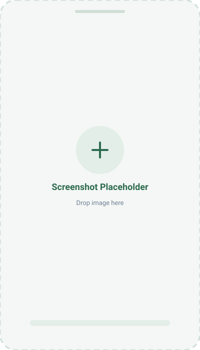

<div align="center">


# Attendance Ledger

**A smart, offline-first college attendance companion that keeps you safely above the threshold without the stress.**

[](https://flutter.dev)
[](https://dart.dev)
[](https://sqlite.org)
[](https://developer.android.com)
[](LICENSE)

[🌐 **GitHub Pages Site**](https://biswas-here.github.io/Attendance-Tracker-for-clg/) · [📦 **Releases Tab**](https://github.com/Biswas-here/Attendance-Tracker-for-clg/releases)

</div>

---

## 💡 The Idea Behind The App

### The College Reality
In almost every college and university, students face a mandatory attendance requirement—most commonly **75% or 80%**. Dropping below this cut-off leads to serious consequences:
- Debarment from semester-end examinations.
- Loss of internal assessment marks.
- Academic penalties, detention, and stressful follow-ups with department heads.

Yet, keeping track manually is surprisingly chaotic:
1. **The Math is Confusing:** Calculating how many classes you can skip before falling below 75% requires constant mental arithmetic after every single lecture and multi-hour lab.
2. **Unreliable Existing Apps:** Most available attendance apps are bloated with invasive banner ads, demand unnecessary sign-ins, upload personal data to unknown cloud servers, or stop working entirely without internet access.
3. **Missed Attendance:** Students frequently forget whether they were marked Present or Absent for a class that took place hours earlier, especially when apps fail to alert them when closed.

### The Solution: Attendance Ledger
**Attendance Ledger** is built with a simple philosophy: **distraction-free, completely private, and mathematically intelligent.**
- **100% Offline-First:** Everything is stored safely on your phone using an embedded SQLite database. No account creation, no cloud syncing, zero trackers, and zero ads.
- **Predictive Bunk Calculation:** Instead of just giving you a percentage, the app tells you in plain words: *"You can safely bunk the next 3 classes"* or *"Attend 2 consecutive classes to recover your 75% target."*
- **Smart Background Alerts:** Interactive notifications pop up right as your class begins, complete with **[PRESENT]** and **[ABSENT]** buttons right on your lockscreen so you don't even have to open the app.

---

## 🛠️ Languages & Technologies Used

Building Attendance Ledger required combining modern cross-platform UI frameworks with low-level native Android system APIs:

| Language / Technology | Role in the App | Description |
|---|---|---|
| **Dart (Dart 3.x)** | Core Logic & Algorithms | Powers the entire application codebase, object-oriented data models, attendance prediction math, and asynchronous event streams with 100% null safety. |
| **Flutter Framework** | UI & Rendering Engine | Google's UI toolkit that renders the warm, paper-crafted Material design with 60 FPS transitions, zero-flicker theme switching, and responsive widgets. |
| **SQL & SQLite (`sqflite`)** | Local Database Storage | Fast, transactional embedded SQL database stored locally on the device for instant offline reads/writes of subjects, schedules, rules, and records. |
| **Kotlin & Android Java** | Native System Layer | Bridges Android `AlarmManager`, `BroadcastReceivers`, and high-priority `NotificationChannels` for reliable background reminders across Android 5.0 to 14+. |
| **C++ & CMake** | Engine Embedding | Handles low-level platform channels, graphics compilation, and the desktop runner execution pipeline. |
| **HTML5 & Modern CSS3** | Documentation & Web | Powers the responsive, styled [GitHub Pages](https://biswas-here.github.io/Attendance-Tracker-for-clg/) landing page and user documentation. |

---

## ✨ Features Breakdown

### 1. 🏠 Live "Class In Session" Dashboard
- Dynamically discovers whatever lecture or lab is active right now based on real-time clock.
- Displays faculty name, room number, and time range in a prominent hero card.
- One-tap toggle allows switching between Present and Absent in seconds.

### 2. 📊 3D Comparison Charts & Bunk Safety
- Beautiful 3D vertical pillar comparison chart across all registered subjects.
- Smart auto-fitting for subjects with long names to keep labels readable and elegant.
- Detailed breakdown per subject: Total sessions held, classes attended, classes absent, and exact margin above/below target.

### 3. 🔔 Reliable Background Notifications
- **Advance Reminder:** Configurable early chime (5, 10, 15, or 30 minutes before class) so you have time to reach the classroom.
- **Class Start Alert:** Pops up at class start time with interactive **[PRESENT]** and **[ABSENT]** buttons on your lockscreen.
- **Post-Class Unmarked Reminder:** If you forget to mark, Android's `AlarmManager` alerts you once the class ends so no lecture slips through the cracks.
- **Intelligent Auto-Dismiss:** Entering the app automatically removes already-started notifications from your notification shade without disturbing upcoming alarms.

### 4. 📅 1-Tap CSV Timetable Import
- Import your entire semester timetable in 5 seconds from an Excel/CSV spreadsheet.
- Automatically parses subject codes, titles, faculty names, and room numbers.
- Generates recurring weekly schedules across 4 to 52 weeks automatically.

### 5. ⚙️ Smart Holiday & Profile System
- Configurable Saturday off pattern (e.g., 2nd & 4th Saturdays, 1st & 3rd, or all Saturdays).
- Custom declared holiday manager to input college-specific festivals or institutional holidays, automatically removing scheduled classes on those days from total attendance.
- Semester milestone tracker with a celebratory screen upon completion of final exams.
- Persistent profile picture and customizable default attendance target (default 75%).

### 6. 📝 Exam & Holiday Planner
- **Full-Day or Half-Day Mode**: Schedule exam periods where regular classes are cancelled, or half-day exams where classes during exam hours are pruned while remaining classes stay intact.
- **In-Between Study Leave**: Optional toggle automatically treats gap days between exams as preparation holidays, excluding them from overall attendance.
- **Exam Attendance Tracking**: Track exam attendance directly on your ledger with designated exam sessions.

### 7. 🌙 Zero-Flicker Light & Dark Themes
- Beautiful paper-textured light theme and OLED-friendly dark mode.
- Caches theme and settings prior to the first frame render to eliminate startup flicker.

---

## 📸 App Screenshots

Below are placeholders reserved for your app screenshots. Drop your image files into `docs/screenshots/` and update these links:

<div align="center">

| 1. Ledger & Schedule | 2. Class In Session | 3. Analytics & Bunk Calc |
|:---:|:---:|:---:|
|  |  |  |
| *Today's Schedule & Attendance* | *Live Ongoing Class with Quick Actions* | *3D Subject Chart & Predictive Advice* |

<br/>

| 4. Timetable & CSV Import | 5. Settings & Profile |
|:---:|:---:|
|  |  |
| *Weekly Timetable & Spreadsheet Import* | *Notification Preferences & Dark Mode* |

</div>

---

## 📦 Releases & Downloads

All official APK builds are hosted directly under the **[Releases Tab](https://github.com/Biswas-here/Attendance-Tracker-for-clg/releases)** in the right sidebar of the repository.

### Versions List

| Version | Status | Release Date | Package Name | Compatible Android | Location |
|---|---|---|---|---|---|
| **v2.0.0 (Version 2.0)** | 🟢 **Latest (Recommended)** | November 2026 | `Attendance-Tracker-v2.0.apk` (or `.zip`) | Android 5.0+ (API 21+) | [**Go to Releases ➜**](https://github.com/Biswas-here/Attendance-Tracker-for-clg/releases) |
| **v1.0.0 (Version 1.0)** | ⚪ Previous Stable | November 2026 | `Attendance-Tracker-v1.0.apk` (or `.zip`) | Android 5.0+ (API 21+) | [**Go to Releases ➜**](https://github.com/Biswas-here/Attendance-Tracker-for-clg/releases) |

### 📲 How To Download (3 Easy Steps)

```
Step 1: Open Releases Tab  ──▶  Step 2: Expand "Assets" on top release  ──▶  Step 3: Tap APK (or ZIP)
```

1. Click on the **[Releases Tab](https://github.com/Biswas-here/Attendance-Tracker-for-clg/releases)** in the sidebar on GitHub.
2. The **latest recommended version (v2.0.0)** is at the top. Under the top release, open the **Assets** section.
3. Tap **`Attendance-Tracker-v2.0.apk`** (or **`Attendance-Tracker-v2.0.zip`**) to download it directly to your phone.
4. If Android asks *"File might be harmful"*, tap **"Download anyway"** *(standard Android security notice for sideloaded APKs)*.
5. Open your downloads folder, tap the APK, and select **Install**!

---

## 🚀 Building From Source

If you want to compile the project yourself:

### Requirements
- [Flutter SDK](https://flutter.dev/docs/get-started/install) (version 3.12 or newer)
- [Android Studio](https://developer.android.com/studio) with Android SDK API 21+
- Java JDK 17

### Steps
```bash
# 1. Clone your repository
git clone https://github.com/Biswas-here/Attendance-Tracker-for-clg.git
cd Attendance-Tracker-for-clg

# 2. Get dependencies
flutter pub get

# 3. Run on a connected Android device or emulator
flutter run

# 4. Build the standalone Release APK
flutter build apk --release
```
The compiled APK will be output to:  
`build/app/outputs/flutter-apk/app-release.apk`

---

## 📄 License

This project is licensed under the **MIT License** — see the [LICENSE](LICENSE) file for details.

---

<div align="center">

Crafted with ❤️ by **Snehasish Biswas**  
GitHub: [@Biswas-here](https://github.com/Biswas-here)

</div>
