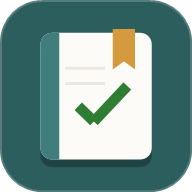
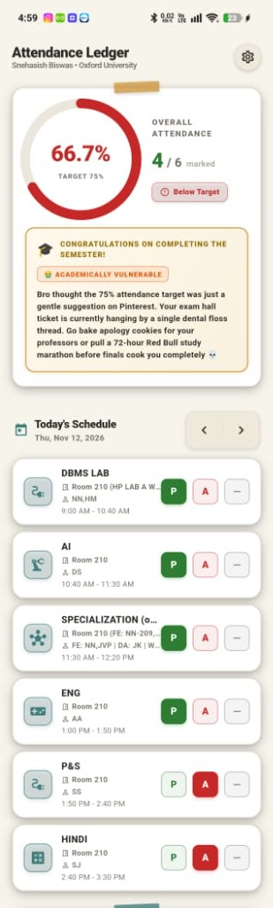
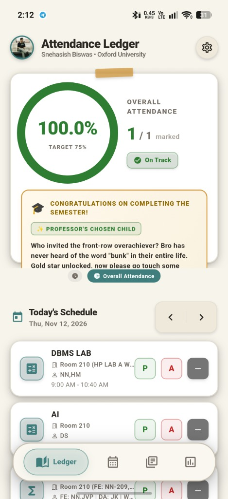
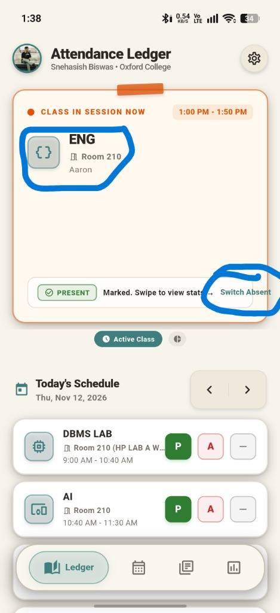
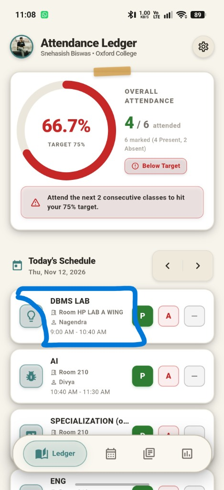

<div align="center">



# 📋 Attendance Ledger

**A smart, beautiful Flutter app to track your college attendance — so you never miss the 75% cut-off again.**

[](https://flutter.dev)
[](https://dart.dev)
[](https://developer.android.com)
[](LICENSE)
[](https://github.com/Biswas-here/Attendance-Tracker-for-clg/releases)

[📥 Download APK](https://github.com/Biswas-here/Attendance-Tracker-for-clg/releases/latest) · [🌐 GitHub Pages](https://biswas-here.github.io/Attendance-Tracker-for-clg) · [🐛 Report a Bug](https://github.com/Biswas-here/Attendance-Tracker-for-clg/issues) · [✨ Request a Feature](https://github.com/Biswas-here/Attendance-Tracker-for-clg/issues)

</div>

---

## 📸 Screenshots

<div align="center">

| Attendance Ledger | Analytics | Subjects | Settings |
|:-:|:-:|:-:|:-:|
|  |  |  |  |

</div>

---

## ✨ Features

### 🏠 Smart Home Dashboard
- **Live "Class in Session" card** — prominently shows your current class with teacher, room, and timing at a glance
- **One-tap P / A marking** — mark Present or Absent right from the schedule; swipe to switch
- **Semester congratulations** — a personalized end-of-semester message once all classes are done
- **Daily schedule navigation** — browse any week's schedule with forward/back arrows

### 📊 Analytics Tab
- **Overall attendance ring** — colour-coded (green/yellow/red) gauge against your target percentage
- **Subject-by-subject comparison** — 3D vertical bar chart with smart text fitting for long subject names
- **Predictive advice** — tells you exactly how many classes you can skip or must attend to stay on track

### 📚 Subjects Management
- Add, edit, and delete subjects with **name, teacher, room number, and attendance target**
- **CSV import** — bulk-import your timetable from a spreadsheet (teacher/faculty & room pulled automatically)
- Subject icons auto-assigned based on name

### 📅 Timetable
- Full weekly timetable view
- Supports labs, lectures, and back-to-back sessions

### 🔔 Smart Notifications
- **Advance reminder** (configurable, off by default) — notifies you before a class starts
- **Unmarked class alert** — notified if you haven't marked attendance after a class ends
- Notifications appear in the **notification panel when the app is closed**
- Notifications auto-dismiss when you open the app; a final prompt shown once after class ends

### 👤 Profile & Personalisation
- Profile photo (persists across app restarts)
- Student name and college name
- **Light / Dark mode** — system-aware with seamless zero-flash transition on startup
- Semester start & end dates

### 🛡️ Reliability
- Local SQLite database — **works 100% offline**, no account needed
- Smooth scroll & animations — no jitter, no lag
- Room number and teacher changes sync instantly across Ledger schedule

---

## 🚀 Getting Started

### Prerequisites

| Tool | Version |
|------|---------|
| Flutter SDK | ≥ 3.0.0 |
| Dart SDK | ≥ 3.0.0 |
| Android SDK | API 21+ |
| Java | 17 |

### Build from Source

```bash
# 1. Clone the repo
git clone https://github.com/Biswas-here/Attendance-Tracker-for-clg.git
cd Attendance-Tracker-for-clg

# 2. Install dependencies
flutter pub get

# 3. Run on a connected device / emulator
flutter run

# 4. Build a release APK
flutter build apk --release
```

> **Note:** The release APK in the [Releases](https://github.com/Biswas-here/Attendance-Tracker-for-clg/releases) page is signed with a debug key — suitable for testing. For production use, set up your own signing keystore.

---

## 📦 Tech Stack

| Layer | Technology |
|-------|-----------|
| **Framework** | Flutter 3.x |
| **Language** | Dart 3.x |
| **Database** | SQLite via `sqflite` |
| **State Management** | `provider` |
| **Charts** | `fl_chart` |
| **Notifications** | `flutter_local_notifications` + `timezone` |
| **File Import** | `file_picker` |
| **Storage** | `path_provider`, `shared_preferences` |
| **Sharing** | `share_plus` |

---

## 📁 Project Structure

```
lib/
├── main.dart                  # App entry point, theme & data init
├── models/                    # Data models (Subject, ClassSession, AttendanceRecord)
├── providers/                 # Provider state management
├── screens/                   # UI screens (Ledger, Subjects, Analytics, Settings)
├── widgets/                   # Reusable UI components
├── services/                  # Notification service, CSV parser
└── utils/                     # Helpers & calculations
```

---

## 📲 Download

Head to the [**Releases**](https://github.com/Biswas-here/Attendance-Tracker-for-clg/releases) page and download the latest APK.

> ⚠️ This is a **debug-signed build** intended for personal testing. Enable "Install from unknown sources" in your Android settings before installing.

---

## 🤝 Contributing

Contributions, issues, and feature requests are welcome!

1. Fork the repository
2. Create a feature branch: `git checkout -b feat/amazing-feature`
3. Commit your changes: `git commit -m 'feat: add amazing feature'`
4. Push to the branch: `git push origin feat/amazing-feature`
5. Open a Pull Request

---

## 📄 License

Distributed under the **MIT License**. See [`LICENSE`](LICENSE) for more information.

---

## 👨‍💻 Author

**Snehasish Biswas**  
GitHub: [@Biswas-here](https://github.com/Biswas-here)

---

<div align="center">

Made with ❤️ and Flutter · © 2026 Snehasish Biswas

</div>
